# 頂尖學霸記憶與學習法深度解析：北一女、建中、台大榜首的高效學習科學全書
(Comprehensive Encyclopedia of Top Students' Learning & Memory Methods: Cognitive Science & Neurobiology Protocols from TFG, CK, NTU & World Academic Achievers)

> 「普通人依賴重複記憶，學霸依賴認知系統與資訊轉化。」  
> 本專題深度調研台灣頂尖學府（北一女中、建國中學、台灣大學醫科/電機/法律等）聯考榜首、國際奧林匹亞競賽選手及全球自學專家的真實實踐，結合**認知心理學**（Cognitive Psychology）與**腦神經科學**（Neurobiology）的深層機制，系統化提煉出 **9 大核心高效學習與記憶法**。
>
> 每一種學習法皆包含：**理論溯源與名校實踐背景**、**腦神經科學深層機轉**、**極致步驟操作規範**、**多學科實戰案例**、**學霸避坑指南**，並全面配備 **至少 2 個高解析架構圖示與 2 個多維度結構分析表格**（全書共計 36+ 組專業圖表）。

---

## 目錄 (Table of Contents)
1. [方法一：北一女「三色階梯錯題本消滅法」 (Three-Color Error Log & Elimination Cycle)](#方法一)
2. [方法二：費曼輸出學習法 (The Feynman Technique: Teach to Learn)](#方法二)
3. [方法三：台大醫科「白紙骨架回想法」 (Blank Sheet Retrieval & Schema Reconstruction)](#方法三)
4. [方法四：康乃爾 5R 筆記法 (Cornell 5R System & Triple-Zone Layout)](#方法四)
5. [方法五：目錄架構與知識樹編碼法 (TOC Knowledge Tree & Mental Anchoring)](#方法五)
6. [方法六：艾賓浩斯間隔重複盒 (Leitner Box & Spaced Repetition Protocol)](#方法六)
7. [方法七：西蒙切片學習法與莫法特交替專注 (Simon Chunking & Moffat Switching)](#方法七)
8. [方法八：北一女「時空雙軸年表與地理套疊筆記法」 (Spatiotemporal Chrono-Spatial Mapping)](#方法八)
9. [方法九：建中「原型母題拆解與一題多解收斂法」 (Paradigm Mother Problem & Multi-Angle Convergence)](#方法九)
10. [跨方法整合：學霸九大心法如何賦能 NChain 記憶體系](#跨方法整合)

---

<a id="方法一"></a>
## 方法一：北一女「三色階梯錯題本消滅法」 (Three-Color Error Log & Elimination Cycle)

### 1. 理論溯源與名校實踐背景
在北一女中與各類聯考三類組榜首的經驗分享中，「錯題本」幾乎是不可或缺的核武級工具。然而，平庸學習者的錯題本往往淪為「抄題藝術展」——耗費大量寶貴自習時間用彩色筆抄寫冗長題目與答案，卻未曾深度剖析錯誤根源；而北一女學霸的精髓在於**「三色病理診斷」**與**「階梯式動態消滅」**：錯題本的終極目標不是越積越厚，而是**「越讀越薄」**，直到考前只剩下薄薄數頁真正的「前額葉盲區」。

### 2. 腦神經科學與認知心理學深層機轉
* **前扣帶迴（Anterior Cingulate Cortex, ACC）誤差偵測**：當大腦預期自己能答對卻突然遭遇挫折（做錯）時，ACC 會發射出負向誤差電位（Error-Related Negativity, ERN），提醒大腦皮質調動額外注意力資源。
* **多巴胺預測誤差學習 (Dopaminergic Prediction Error Learning)**：神經可塑性在「預期結果與實際結果產生巨大落差」時最強烈。黑筆還原錯誤思路、紅筆直指突破口，能直接活化突觸前膜釋放麩胺酸，打破原先錯誤突觸傳導路徑。
* **破除「流暢性錯覺 (Illusion of Fluency)」**：學習者看著參考書詳解時，大腦會誤判「我本來就會」，三色法強制進行閉卷重現，進行嚴格的元認知校準。

### 3. 操作三原則與階梯流動法
1. **拒絕全文手抄**：利用便攜式標籤機、影印剪貼或裁紙刀，30 秒內將原題貼在專用錯題本上。
2. **三色嚴格劃分**：
   - ⬛ **黑筆（情境與軌跡）**：貼上原題，忠實還原當時考場上的錯誤切入點與計算斷點。
   - 🟥 **紅筆（破題核心步）**：只寫出題目的「解題關鍵突破口（Trigger Point）」與核心定理，拒絕廢話。
   - 🟦 **藍筆（思維後設標籤）**：提煉核心盲點、預防口訣及題目變形提示（如：「又漏看定義域 $x > 0$！」「此題表面為幾何，實為向量內積」）。
3. **階梯消滅機制（3-7-21 法則）**：
   - **Day 1**：訂正入庫。
   - **Day 3**：遮蓋解答盲算一次；若順暢答對，打第一個「✓」；若答錯，藍筆加重警語。
   - **Day 7**：變形題測試或再次遮蓋演算；答對打第二個「✓」。
   - **Day 21**：考前總清點；累積連續三次「✓」者，直接用螢光筆劃除（消滅），退出複習隊列。

### 4. 搭配圖示與表格

#### 【圖示 1-1】錯題消滅生命週期與三階過濾漏斗
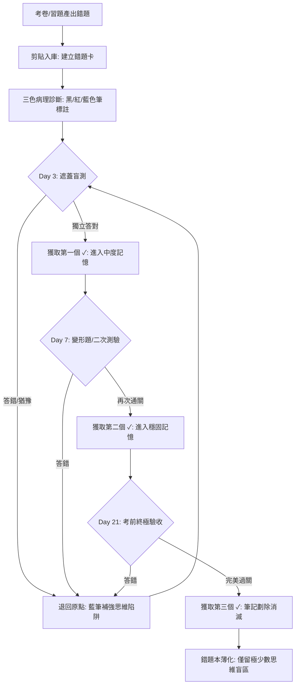

#### 【圖示 1-2】錯題診斷決策樹：判斷是否入庫與處置流程
```mermaid
flowchart TD
    Q0[做錯一道題目] --> Q1{錯因是否為純計算失誤?}
    Q1 -- 是 (如 3x7=24) --> A1[當場訂正, 不入錯題本, 避免雜訊]
    Q1 -- 否 --> Q2{是否為概念完全不懂?}
    Q2 -- 是 (知識黑洞) --> A2[回到課本重新精讀該小節, 再做基礎題]
    Q2 -- 否 --> Q3{是否為模型辨識/隱藏條件遺漏?}
    Q3 -- 是 (核心高價值錯題) --> B1[立刻剪貼入庫]
    B1 --> B2[黑筆寫下當時的假想與卡殼步驟]
    B2 --> B3[紅筆標註觸發關鍵字 (Trigger Word)]
    B3 --> B4[藍筆提煉防禦口訣, 啟動 3-7-21 追蹤]
```

#### 【表格 1-1】北一女三色筆註記規範與認知歸因維度分析表
| 色彩分區 | 工具類型 | 紀錄內容與格式 | 認知防禦心法 | 實戰示範警語 |
| :--- | :--- | :--- | :--- | :--- |
| **黑色 (Black)** | 0.5mm 黑色筆 / 影印剪貼 | 原始題目 + 當初考場錯誤算式 | **直面斷點**：忠實暴露思維在哪一步產生邏輯跳躍，絕不粉飾錯誤。 | *「誤將等比首項代為 1，忽略 $n=0$ 邊界」* |
| **紅色 (Red)** | 0.5mm 紅色中性筆 | 突破口定理 + 精簡正解鏈 | **突觸錨定**：只寫從卡住到豁然開朗的關鍵 1~2 步核心定理。 | *「反向代換：令 $t = x + \frac{1}{x}$，利用算幾不等式求極值」* |
| **藍色 (Blue)** | 0.5mm 藍色筆 | 錯誤歸因標籤 + 警語 + 進度 (✓) | **前額葉元認知反思**：區分知識盲點、程序失誤或邊界條件忽略。 | *「【警語】看見對數必先寫真數 $> 0$！進度：[✓][✓][ ]」* |

#### 【表格 1-2】北一女學霸錯題溯源檢核單與 3-7-21 動態追蹤日程表
| 欄位名稱 | 檢核內容範例 | 處置行動方針 | 預期神經強化成果 |
| :--- | :--- | :--- | :--- |
| **題源與編號** | 114 年全模數學科第 12 題 (多選) | 註明出處便於未來調閱原卷對照難度。 | 建立考題情境索引。 |
| **考點所屬知識樹** | 高中數學冊三：空間向量 ➔ 柯西不等式 | 標註對應的知識樹枝條位置。 | 將錯誤掛載回宏觀知識架構。 |
| **陷阱維度分類** | [ ] 觀念盲區  [✓] 隱藏邊界條件  [ ] 解題模型選錯 | 統計個人易錯型態，考前針對性防範。 | 提高 ACC 前扣帶迴之敏感度。 |
| **3-7-21 複習進度** | • D+3 盲測：[✓] 通過 (09/26)<br>• D+7 變形：[✓] 通過 (09/30)<br>• D+21 驗收：[ ] 待測 (10/14) | 若任一階段卡殼，立即打回 D+3 重新計時。 | 確保記憶固化超越遺忘臨界點。 |

---

<a id="方法二"></a>
## 方法二：費曼輸出學習法 (The Feynman Technique: Teach to Learn)

### 1. 理論溯源與名校實踐背景
由諾貝爾物理學獎得主理查·費曼（Richard Feynman）提出。在建國中學與台灣大學電機、醫科學霸圈中，這常被稱為「小黃鴨調試法（Rubber Duck Debugging）」或「解題給同學聽法」。學霸往往熱衷於「當小老師」，這並非單純利他，而是在藉由向他人講述，對自身認知系統進行極限壓力測試。

### 2. 腦神經科學與認知心理學深層機轉
* **生成效應 (Generation Effect)**：主動產出語句時，大腦會調動左半球布羅卡區（Broca）與威尼克區（Wernicke），將散落神經元重新組裝為結構化的語意網絡。
* **破除「解釋深度錯覺 (Illusion of Explanatory Depth)」**：心理學家 Rozenblit & Keil 研究顯示，大多數人以為自己理解腳踏車或拉鍊的運作原理，直到被要求畫出齒輪鏈條時才發現無法解釋。費曼法強制拆解語意，讓假懂無所遁形。
* **多感官運動回饋**：口述輸出時，聽覺皮質與發音運動神經系統會同步監控語音內容，提供雙向神經回饋。

### 3. 操作四大黃金步驟
1. **Step 1：確定目標概念 (Concept)**：在空白紙頂端寫下要攻克的定理（如：「光電效應」、「勒沙特列原理」）。
2. **Step 2：向小白假想教學 (Teach to an 8-year-old Child)**：假想面前坐著一位小學三年級學生，不允許使用任何學術黑話與公式堆砌，用大白話與童趣比喻講述。
3. **Step 3：定位卡殼與除錯 (Identify Gaps & Review)**：當你發現自己必須說出「這就是定義啦」、「反正背起來就對了」或語塞時，這正是你的認知斷點；立刻翻開教科書追根究柢。
4. **Step 4：簡化與二次昇華 (Simplify & Refine)**：提煉日常比喻，直到能一氣呵成、毫無阻塞地講述。

### 4. 搭配圖示與表格

#### 【圖示 2-1】費曼輸出閉環與知識除錯循環圖
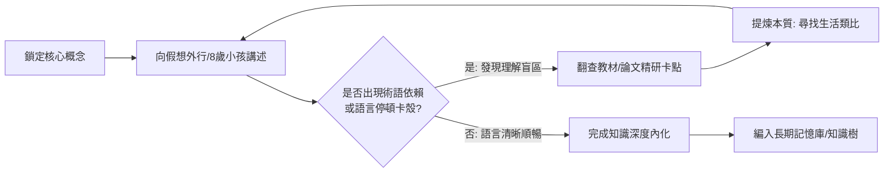

#### 【圖示 2-2】費曼轉譯之神經資訊流向模型
```mermaid
flowchart TD
    subgraph 傳統被動輸入
        In1[課本符號與公式] --> In2[初級視覺皮質 V1]
        In2 --> In3[短期工作記憶 (約 15 秒後流失)]
    end
    subgraph 費曼主動輸出神經網絡
        Out1[符號與定義] --> Out2[前額葉解構為本質要素]
        Out2 --> Out3[語言區 Broca/Wernicke 語意重構]
        Out3 --> Out4[運動皮質發音/手寫輸出]
        Out4 --> Out5[聽覺皮質雙向回饋監控]
        Out5 --> Out6[海馬迴突觸長時程增強 (LTP)]
    end
```

#### 【表格 2-1】高階抽象概念轉譯成孩童日常生活隱喻對照表
| 學術主題 | 教科書生硬定義 | 費曼轉譯：8 歲小孩懂的生活比喻 | 認知底層機制與生活錨點 |
| :--- | :--- | :--- | :--- |
| **物理：熵增定律** | 孤立系統總混亂度恆增，熱量不可逆自低溫流向高溫。 | 「就像你的房間：如果不主動花力氣去收拾打掃，它只會自己變得越來越亂，絕不會自己變乾淨！」 | 不作功 $\to$ 不花力氣<br>熵增 $\to$ 房間變亂 |
| **計算機：快取記憶體** | 位於 CPU 與 RAM 間超高速暫存記憶體，減少存取延遲。 | 「就像書桌抽屜：常用鉛筆放抽屜隨手拿（Cache），整套百科全書放遠處大書架（RAM）。」 | 記憶體階層 $\to$ 抽屜 vs 書架 |
| **神經科學：突觸可塑性** | 神經元間突觸傳導強度隨頻繁刺激增強或減弱 (LTP)。 | 「草地上本來沒有路，但只要兩家小朋友天天互相走動串門，草地就會被踩出一條又寬又平的大大道。」 | 赫布定律 $\to$ 常走踩出大道 |
| **化學：化學平衡移動** | 系統受到外界條件改變時，平衡將朝著減弱此外界改變的方向移動。 | 「就像在擁擠的捷運車廂：右邊門突然湧進一大群人，大家就會不由自主地往左邊空位挪過去。」 | 勒沙特列 $\to$ 捷運挪位 |

#### 【表格 2-2】費曼學習法四大步驟自我診斷評估量規 (Rubric)
| 階段步驟 | 卓越 (Level 4) | 合格 (Level 3) | 待加強 (Level 2) | 未入門 (Level 1) |
| :--- | :--- | :--- | :--- | :--- |
| **1. 概念界定** | 精準寫出概念本質及邊界條件。 | 能寫出核心公式與主要名稱。 | 概念範圍模糊，常與相鄰概念混淆。 | 無法獨立寫出核心主旨。 |
| **2. 白話講述** | 完全無術語，用生活場景一氣呵成。 | 偶爾使用專業詞，但能即時補救解釋。 | 嚴重依賴術語背誦，脫離課本即語塞。 | 照本宣科，念課本句子。 |
| **3. 盲點定位** | 敏銳捕捉「為什麼會這樣」的卡頓點。 | 能發現自己哪一步公式記不清楚。 | 感覺不順，但不知問題出在哪。 | 自認全懂，拒絕承認卡殼。 |
| **4. 比喻重構** | 提出具神來之筆的原創精準比喻。 | 能借用他人的生動比喻解釋。 | 比喻牽強，邏輯有重大漏洞。 | 無法提出任何比喻。 |

---

<a id="方法三"></a>
## 方法三：台大醫科「白紙骨架回想法」 (Blank Sheet Retrieval & Schema Reconstruction)

### 1. 理論溯源與名校實踐背景
台大醫科、榜首級高材生在面對解剖學、生理學、生物化學等「海量資訊轟炸」時，最忌諱拿著螢光筆畫課本反覆重讀（Passive Rereading）。真正的學霸在讀完一個章節後，會立刻闔上書本，抽出一張**「完全空白的 A4 紙」**，憑記憶在紙上默寫出整章的心智結構、定義與推導流程。寫不出來的空白處，就是最真實的考分漏洞。

### 2. 腦神經科學與認知心理學深層機轉
* **提取練習效應 (Testing / Retrieval Effect)**：心理學家 Roediger & Karpicke (2006) 經典實驗證實：反覆學習（SSSS）在短期測驗看似流暢，但一週後的記憶留存率崩跌；而「學習後反覆提取測試（STTT）」的長期留存率比重讀組高出 **400%**。
* **海馬迴之模式完成 (Pattern Completion)**：當白紙上寫下主幹時，海馬迴 CA3 區會根據部分線索，強行激發全腦皮質神經網絡進行聯想補全，這是生物學上最強固的記憶鞏固過程。
* **「有益的困難 (Desirable Difficulties)」**：大腦在提取記憶時感受到的發熱、疲累與挫折感，正是突觸長時程增強作用（LTP）發生的生物化學訊號。

### 3. 三階實施流程：骨架 ➔ 血肉 ➔ 補洞
1. **第一階：畫出粗壯骨架 (Skeleton - 5 分鐘)**：
   - 閉卷不看書。用黑筆在白紙中央寫出章節主幹，往外延伸 3~5 個一級分支與二級子節點。
2. **第二階：填充微觀血肉 (Flesh - 15 分鐘)**：
   - 在每個子節點下方，默寫出代表性的公式推導、核心名詞定義、實驗流程或比較矩陣。
   - 遇到想不起來的細節，**絕對不能偷看書**，先用「問號 ❓」佔位跳過，保持思維流暢。
3. **第三階：紅筆對照補洞 (Red Patching - 10 分鐘)**：
   - 翻開教材，以紅色筆對照比對。
   - 用紅筆將空白處、漏掉的關鍵條件、寫錯的推導補在白紙上。
   - **這張「布滿紅筆補丁的白紙」就是你個人的專屬高價值複習清單**。

### 4. 搭配圖示與表格

#### 【圖示 3-1】白紙骨架構建與「骨架-血肉-補洞」演進圖
```mermaid
graph TD
    subgraph 階段一：建立骨架 (閉卷·黑筆 5min)
        M[中央核心主題] --> A[一級分支: 原理架構]
        M --> B[一級分支: 核心公式]
        M --> C[一級分支: 應用場景]
    end
    subgraph 階段二：填充血肉 (回想·深色 15min)
        A --> A1[二級節點: 定義名詞]
        A --> A2[二級節點: 前提假設]
        B --> B1[二級節點: 推導步驟]
        B --> B2[二級節點: 邊界條件 ❓卡殼]
    end
    subgraph 階段三：開卷診斷 (對照·紅筆 10min)
        B2 -. 開卷翻查補正 .-> R1[🟥 紅筆補齊: 忽略極限值收斂條件]
        C -. 發現遺漏分支 .-> R2[🟥 紅筆補齊: 典型變形考題模型]
    end
```

#### 【圖示 3-2】白紙主動提取與突觸生長微觀神經機制
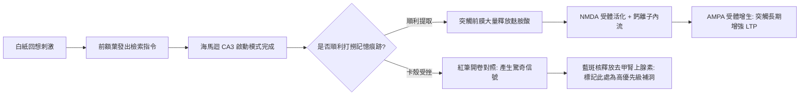

#### 【表格 3-1】被動重複閱讀法 vs 白紙主動回想法之全維度科學對照表
| 評估維度 | 被動重複閱讀法 (Passive Rereading) | 台大醫科白紙骨架回想法 (Active Blank Retrieval) | 腦神經與心理學原理支撐 |
| :--- | :--- | :--- | :--- |
| **大腦涉入深度** | 低度（僅初級視覺皮質 V1 接收光訊號） | **極高（前額葉、顳葉、海馬迴同步高頻放電）** | 無提取不記憶；被動閱讀難以生長樹突棘。 |
| **主觀感受** | 順暢、有虛假成就感 | 費力、大腦有燃燒感、直面遺忘挫折 | 心理學著名概念：**「有益的困難 (Desirable Difficulties)」**。 |
| **一週後留存率** | 急速衰退至 15% ~ 25% | **穩固維持在 70% ~ 85%** | 主動打撈促使短期記憶鞏固為大腦皮質長期記憶。 |
| **考場應變能力** | 題目微變形即無法提取公式 | 知識呈網狀索引，隨調隨用 | 具備高解析度心智索引（Mental Schema）。 |

#### 【表格 3-2】跨學科白紙回想演練範本與時間分配表
| 學科領域 | 白紙骨架 (階段一) 默寫焦點 | 細節血肉 (階段二) 填充內容 | 紅筆補洞 (階段三) 診斷重點 |
| :--- | :--- | :--- | :--- |
| **高中數學** | 章節核心定理、幾何定義、適用條件 | 核心公式代數推導、極端值、反例圖形 | 忽略邊界定義域（如 $x > 0$、分母非 0）。 |
| **物理化學** | 基本定律、守恆律、狀態方程式 | 物理量單位因次、受力分析自由體圖、反應機構 | 忘記適用前提（如等加速度、孤立系統、理想氣體）。 |
| **生物地科** | 生理系統流程圖、循環路徑、地質構造 | 荷爾蒙分泌調控拮抗表、胞器特徵、岩石分類 | 專有名詞中英文錯別字、上下游回饋迴路混淆。 |
| **文史地理** | 時代時間軸骨幹、板塊氣候成因大圖 | 重大戰役和約條件、季風洋流影響、文化流變 | 年代先後倒置、地理地形與經濟作物的因果對應錯誤。 |

---

<a id="方法四"></a>
## 方法四：康乃爾 5R 筆記法 (Cornell 5R System & Triple-Zone Layout)

### 1. 理論溯源與名校實踐背景
由康乃爾大學 Walter Pauk 教授創立，為北一女學霸筆記最常見的版型基礎。許多學生抄筆記是「滿版流水帳」，導致考前根本不知從何看起。康乃爾筆記法將頁面科學切割為 **「黃金三大板塊」**，並串聯成貫穿「課堂-當日-週末-考前」的 **5R 週期性動線**。

### 2. 腦神經科學與認知心理學深層機轉
* **意元集組 (Chunking Theory)**：大腦工作記憶一次只能處理 $7 \pm 2$ 個組塊。右側筆記欄將龐雜資訊壓縮為左側線索欄的少數「核心錨點」，有效減輕認知負荷。
* **雙碼理論 (Dual-Coding Theory)**：文字紀錄（右）搭配圖像線索/問題提示（左）與概括提煉（下），促使大腦視覺通道與語言通道同時激發。

### 3. 康乃爾 5R 操作手冊
1. **Record（記錄）**：在課堂或閱讀時，於**主筆記欄（右 70%）**快速記錄主幹事實、關鍵算式、推論流程，留適度空白。
2. **Reduce（簡化/提煉）**：課後 24 小時內，於**線索欄（左 30%）**提煉出核心關鍵字、提示問題或核心概念標籤。
3. **Recite（遮蓋背誦）**：複習時用紙遮住右側筆記欄，僅看左側線索欄的問題，強迫自己大聲說出或默想右側內容。
4. **Reflect（反思連結）**：在頁面**底部總結區（下 20%）**，用 2~3 句話總結本頁精華，並思考其與其他章節的跨科關聯。
5. **Review（週期複習）**：每週拿出筆記，花 10 分鐘快速看左側與底部，進行間隔式自我抽測。

### 4. 搭配圖示與表格

#### 【圖示 4-1】康乃爾三分割黃金版面配置與動線幾何圖
```
+-------------------------------------------------------------------+
| 標題：電磁感應與法拉第定律            日期：2026-09-23    頁數：01 |
+-------------------------------+-----------------------------------+
| 【左側：線索/提問欄】 (30% 寬)  | 【右側：課堂筆記欄】 (70% 寬)        |
|  * 課後 24h 提煉關鍵提問       |  * 課堂聽講/看書即時主幹記錄        |
|  * 遮蓋複習時的測驗題庫        |  * 記錄定理、公式、推導、例題      |
|                               |                                   |
| Q1: 磁通量變化的本質是什麼？    | 1. 法拉第電磁感應定律：            |
|                               |    ε = -N (dΦB / dt)             |
| Q2: 負號的物理意義是？         |    - 負號源自冷次定律 (能量守恆)   |
|     (冷次定律)                | 2. 感應電動勢三大來源：           |
|                               |    - B 變 (感生電動勢)             |
| Q3: 動生與感生電動勢區別？    |    - 面積 A 變 (動生: ε = BLv)   |
|                               |    - 夾角 θ 變 (交流發電機原理)    |
| [速記標籤]                     | [圖示] 導線切割磁力線受力分析...   |
| #物理 #電磁學 #常考大題        |                                   |
+-------------------------------+-----------------------------------+
| 【底部：總結摘要欄 Summary】 (高約 5~7 公分，佔頁面下緣 20%)        |
|  * 用自己的話精煉 2-3 句總結：                                     |
|  感應電動勢的核心在於「磁通量改變率」，冷次定律本質是能量守恆抵抗外變。 |
|  考題通常分動生 (BLv) 與感生 (dB/dt) 兩大模型解題。                 |
+-------------------------------------------------------------------+
```

#### 【圖示 4-2】康乃爾 5R 記憶流向與認知階段轉移圖
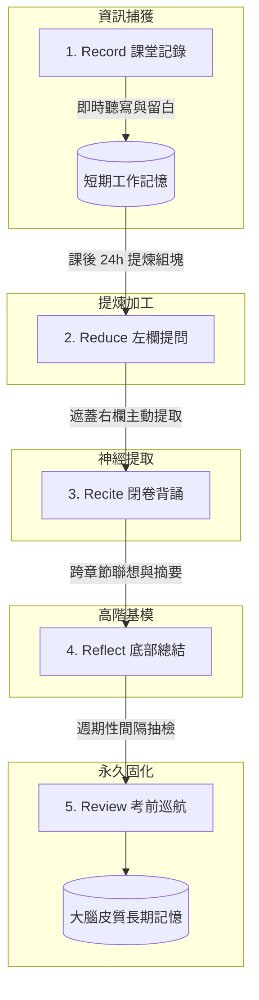

#### 【表格 4-1】康乃爾 5R 執行週期時間分配與具體操作指引表
| 5R 階段名稱 | 執行時機 | 占用時間 | 產出成果與檢驗標準 | 對應認知神經機制 |
| :--- | :--- | :--- | :--- | :--- |
| **1. Record (記錄)** | 課堂聽講時 | 約 45 分鐘 | 右欄主筆記：記錄骨幹概念、公式推導與例題。 | 感官工作記憶接收與初步過濾。 |
| **2. Reduce (簡化)** | 課後黃金 24h 內 | 10~15 分鐘 | 左欄提煉出 3~5 個「提問式標題」與核心關鍵詞。 | 資訊意元組塊化 (Chunking)。 |
| **3. Recite (背誦)** | 隔日早自習 | 10 分鐘 | 手遮右欄，只看左欄提問，口述還原右側答案。 | 主動神經提取練習 (Active Recall)。 |
| **4. Reflect (反思)** | 單元結束當天 | 5 分鐘 | 底部填入 2~3 句本質總結，標出跨單元連結。 | 高階語意整合與心智基模擴展。 |
| **5. Review (複習)** | 週末與考前 | 5 分鐘/頁 | 掃描底部摘要與左欄問題，無猶豫即可打勾通關。 | 對抗遺忘曲線，突觸長時程增強。 |

#### 【表格 4-2】康乃爾筆記法跨學科版面實戰應用對照表
| 學科類型 | 左側線索欄 (Reduce) 填寫策略 | 右側主筆記欄 (Record) 記錄焦點 | 底部摘要欄 (Summary) 核心任務 |
| :--- | :--- | :--- | :--- |
| **數理計算科** | 寫下「題型識別特徵」與「破題發問」。(如：何時用動量而非能量？) | 寫下代表性母題的完整推導與幾何輔助線。 | 提煉解題口訣與常見陷阱條件（如 $m_1 \ll m_2$）。 |
| **文史社會科** | 寫下「歷史轉折關鍵詞」、「制度利弊提問」。 | 條列年代事件演進、因果分析、社會經濟結構。 | 用一句話總結該歷史時代的本質特徵。 |
| **外語學習科** | 寫下核心生字、同義字詞根、搭配介系詞提問。 | 記錄原汁原味例句、長難句語法分析與慣用語。 | 用所學的 3 個新單字自己造一段完整短文。 |
| **程式演算法** | 寫下函數時間/空間複雜度 $O(N)$、邊界 Case 提問。 | 記錄清晰虛擬碼 (Pseudocode)、指針變換追蹤。 | 總結核心思想（如：雙指針滑動窗口、動態規劃轉移式）。 |

---

<a id="方法五"></a>
## 方法五：目錄架構與知識樹編碼法 (TOC Knowledge Tree & Mental Anchoring)

### 1. 理論溯源與名校實踐背景
台大法律系、醫學系準備國家考試與百萬字教材的終極心法。拒絕逐頁死啃，而是「先背熟目錄地圖，再進森林伐木」。學霸在面對厚重的《民法總則》或《哈里遜內科學》時，第一步不是閱讀內文，而是花整整三天將「目錄層次」銘刻進腦海。

### 2. 腦神經科學與認知心理學深層機轉
* **基模理論 (Schema Theory)**：新知識必須附著在既有心智基模上。如果沒有架構，零碎知識如同散落零件，迅速流失。
* **頂層認知加工 (Top-Down Processing)**：前額葉在具備宏觀架構預期時，能對傳入的新細節進行極高效率的分類與索引。
* **海馬迴空間認知地圖 (Cognitive Map)**：大腦位置細胞（Place Cells）與網格細胞（Grid Cells）天生擅長處理空間層級關係，樹狀結構將抽象符號轉化為空間座標。

### 3. 操作三部曲：砍伐樹幹 ➔ 分出主枝 ➔ 繁茂綠葉
1. **第一步：目錄刻印（樹幹）**：背誦全書大章節標題及其邏輯先後順序。
2. **第二步：二級節點定位（大枝）**：在每個章節下，列出其下屬的 3~4 個小節核心原理或推導主線。
3. **第三步：掛載題型與細節（樹葉）**：做題目時，強迫大腦發問：「這道題是長在哪一根樹枝上？」，將例題掛載至節點。

### 4. 搭配圖示與表格

#### 【圖示 5-1】學科知識樹階層式結構與心智錨定圖
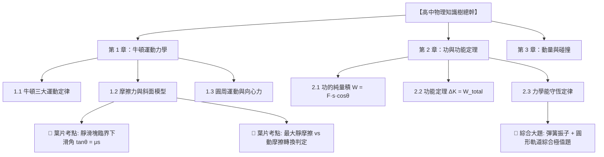

#### 【圖示 5-2】跨章節綜合大題之知識樹枝條交匯破題流
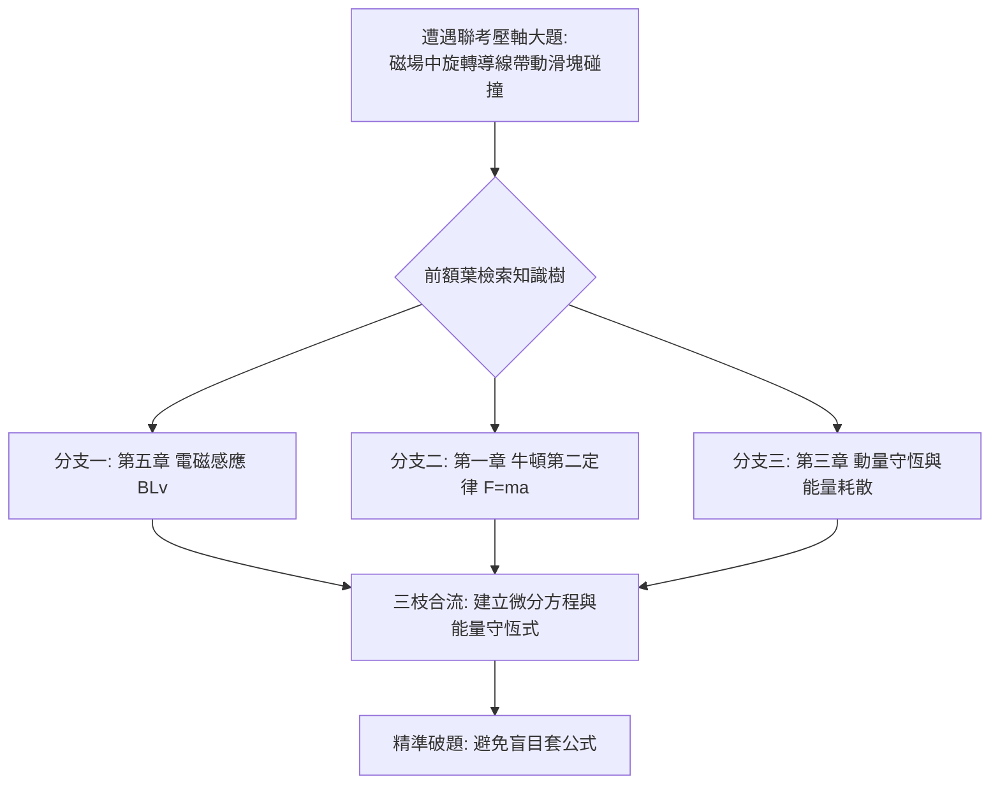

#### 【表格 5-1】傳統線性逐頁閱讀 vs 目錄知識樹心智錨定全維度比較表
| 評估維度 | 傳統線性逐頁閱讀 (Linear Reading) | 目錄知識樹編碼 (TOC Tree Anchoring) | 實戰效果差距 |
| :--- | :--- | :--- | :--- |
| **心智模型** | 碎片化，「只見樹木不見森林」 | 網狀立體，「居高臨下鳥瞰全局」 | 考題稍微變形，樹狀學習者能秒認出題單元。 |
| **吸收效率** | 像往無序雜物間塞東西，越塞越亂 | 新知識精確掛載至對應枝椏，井然有序 | 充分利用基模同化，節省 50% 吸收時間。 |
| **提取速度** | 苦思「我好像在哪看過但想不起」 | 毫秒級定位：「第 2 章 ➔ 第 3 節 ➔ 公式 2」 | 徹底消除考場上大腦一片空白的恐慌。 |
| **綜合題破解** | 看不出跨章節考點關聯 | 一眼看出融合了「力學」與「電磁學」兩根大枝 | 聯考壓軸跨章節大題的唯一破解法。 |

#### 【表格 5-2】一本教材知識樹工程三階段施工指引表
| 施工階段 | 目標與時間預算 | 核心產出物 | 驗收合格檢驗標準 |
| :--- | :--- | :--- | :--- |
| **第一階段：立幹分枝** | 開學前 / 新書啟動 (約 2 小時) | 一張 A4 紙手繪目錄骨架樹。 | 閉上眼能一口氣背出全書 10 大章標題及前後邏輯鏈。 |
| **第二階段：生枝添葉** | 日常上課與精讀 (隨進度每週 1 小時) | 在二級節點下補齊關鍵定義、公式及 1~2 道典型母題。 | 看到任何一節課本內容，能精確說出其在樹狀圖的位置。 |
| **第三階段：疏枝穿引** | 期中考 / 考前兩週 (約 3 小時) | 用彩色虛線畫出跨章節的關聯線（如：電磁學連回動量）。 | 能給出任兩章之間的交集概念，完成跨單元貫通。 |

---

<a id="方法六"></a>
## 方法六：艾賓浩斯間隔重複盒 (Leitner Box & Spaced Repetition Protocol)

### 1. 理論溯源與名校實踐背景
由德國心理學家塞巴斯蒂安·萊特納（Sebastian Leitner）於 1972 年發明，也是當前全球頂尖學習軟體 Anki 的底層邏輯。建中數理資優班、外語競賽金牌得主常以此法記憶大量公式、化學反應式、專利代碼或生字。傳統複習是「每天把全部卡片看一遍」，容易產生審美疲勞；萊特納盒將卡片依「熟悉度」分流，**把 80% 的精力專注在即將遺忘與易錯的卡片上**。

### 2. 腦神經科學與認知心理學深層機轉
* **艾賓浩斯遺忘曲線 (Forgetting Curve)**：記憶在形成後的首個 24 小時內衰減最為劇烈（流失約 70%）。如果在**「即將遺忘的臨界點（Desirable Difficulty）」**給予一次神經提取刺激，大腦會將該突觸連結的固化係數提升數倍，遺忘曲線隨之顯著平緩。
* **分流效率最大化**：熟練的資訊間隔拉長，不熟的資訊高頻衝擊，實現大腦代謝資源的最佳化分配。

### 3. 五級卡盒昇降規則 (The 5-Box Leitner Engine)
* **Box 1 (每日盒)**：所有新卡片進入此盒，每天檢驗一次。
* **Box 2 (隔天盒)**：Box 1 答對者升至此盒，每 3 天檢驗一次。
* **Box 3 (每週盒)**：Box 2 答對者升至此盒，每週檢驗一次。
* **Box 4 (雙週盒)**：Box 3 答對者升至此盒，每兩週檢驗一次。
* **Box 5 (永久記憶盒)**：Box 4 答對者進入，每月檢驗或考前總複習。
* ⚠️ **【鐵血降級規則】**：任何盒子（哪怕是 Box 4 或 5）中的卡片，只要**答錯一次，立即重摔回 Box 1**，絕不容忍半點模糊！

### 4. 搭配圖示與表格

#### 【圖示 6-1】萊特納五級升降盒狀態轉移圖
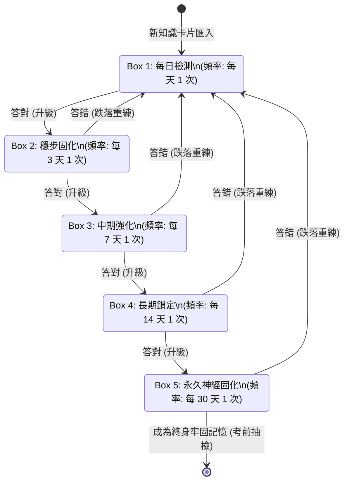

#### 【圖示 6-2】間隔重複刺激下的神經記憶留存率平緩曲線
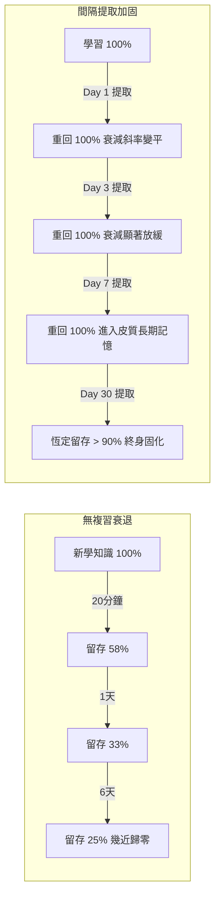

#### 【表格 6-1】遺忘曲線臨界間隔時間排程與 5 級卡盒檢驗頻率表
| 卡盒等級 | 複習間隔週期 | 大腦留存率預估 | 升級 / 降級判定條件 | 神經生理狀態 |
| :--- | :--- | :--- | :--- | :--- |
| **Box 1 (衝刺盒)** | **每日 (Day 1)** | ~ 50% | 答對 ➔ 升 Box 2；答錯 ➔ 留在 Box 1 稍後再測 | 海馬迴剛寫入短期記憶，極不穩定。 |
| **Box 2 (初級盒)** | **每 3 天 (Day 3)** | ~ 65% | 答對 ➔ 升 Box 3；答錯 ➔ 跌回 Box 1 重練 | 初級突觸增強，首次抗阻遺忘。 |
| **Box 3 (中級盒)** | **每 7 天 (Day 7)** | ~ 75% | 答對 ➔ 升 Box 4；答錯 ➔ 跌回 Box 1 重練 | 訊號由海馬迴向顳葉皮層投射轉化。 |
| **Box 4 (鞏固盒)** | **每 14 天 (Day 14)** | ~ 85% | 答對 ➔ 升 Box 5；答錯 ➔ 跌回 Box 1 重練 | 皮質神經迴路建立完備，抗干擾力強。 |
| **Box 5 (永久盒)** | **每 30 天 (Day 30+)** | **> 95%** | 答對 ➔ 保持在 Box 5；答錯 ➔ 跌回 Box 1 重練 | 長時程永久固化，達到直覺反射。 |

#### 【表格 6-2】抽認卡卡片製作心法與避坑檢查表
| 項目標準 | 優質卡片範例 (High Yield) | 劣質卡片避坑 (Low Yield) | 背後科學原理 |
| :--- | :--- | :--- | :--- |
| **原子化原則** | 正面：光的干涉臨界條件？<br>背面：$\Delta x = \frac{\lambda L}{d}$ | 一張卡片塞下整個光學章節全部公式與定義。 | 大腦工作記憶容易超載，難以定位盲點。 |
| **雙向提問** | A 卡：公式推導名稱；<br>B 卡：給名稱寫出公式。 | 只有單向被動識別。 | 建立雙向突觸檢索通道。 |
| **圖像化錨定** | 搭配簡圖或 NChain 形象樁符號。 | 只有枯燥密集的純文字。 | 雙碼理論，視覺記憶持久度提升 3 倍。 |

---

<a id="方法七"></a>
## 方法七：西蒙切片學習法與莫法特交替專注 (Simon Chunking & Moffat Switching)

### 1. 理論溯源與名校實踐背景
由諾貝爾經濟學獎、圖靈獎雙料得主赫伯特·西蒙（Herbert Simon）提出。西蒙曾斷言：「任何一個人可以在 6 個月內掌握任何一門學科，秘訣在於**單點極致聚焦與組塊化切割**。」建中奧賽選手在短期集訓攻克高難度專題（如一個月攻破大一微積分），以及台大學霸跨考跨修不同領域時，均廣泛採用西蒙學習法；同時搭配英國心理學家莫法特（Moffat）的**「大腦皮層交替專注法則」**，徹底解決長時間深度學習帶來的認知枯竭。

### 2. 腦神經科學與認知心理學深層機轉
* **專家心理組塊 (Expert Chunking)**：西蒙研究西洋棋大師發現，大師之所以看一眼棋盤就能記住走法，並非短期記憶力異於常人，而是腦中儲存了約 50,000 個「棋局組塊（Chunks）」。學習的本質就是將零星資訊組裝為高階結構組塊。
* **大腦皮層分區興奮與抑制 (Cortical Alternation)**：神經生物學顯示，負責高強度邏輯推演的是前額葉與左側頂葉；負責視覺空間與藝術的是右半球；負責運動與節奏的是小腦與運動皮質。如果連續 6 小時只算數學，前額葉神經遞質（多巴胺、去甲腎上腺素）會快速耗盡；此時切換至背誦英文或聽音樂運動，既能讓邏輯神經區「主動休息修復」，又不會停止學習進度。

### 3. 西蒙切片與莫法特交替實踐指南
1. **西蒙切片 (Narrow Focus & Chunk Decomposition)**：
   - 拒絕同時間開 5~6 門不同新課。
   - 挑出核心攻堅目標（例如：「極限與微分法」）。
   - 切分為極小模塊（極限定義 $\to$ 單側極限 $\to$ 洛必達法則 $\to$ 泰勒展開式），以 2~3 週為衝刺期，集中火力單點擊穿。
2. **莫法特交替時間軸 (Cortical Switching Schedule)**：
   - **90 分鐘專注衝刺（超晝夜節律 Ultradian Rhythm）**：進入西蒙式深度工作，單一科目，隔絕所有手機通知。
   - **科目性質大跨度切換**：
     - 區塊 1 (08:30-10:00)：邏輯推演（數學微積分 / 物理力學）——*燃燒左腦前額葉*
     - 區塊 2 (10:15-11:45)：語言記憶（英文生字 / 國文詩詞默寫）——*調動顳葉語意區*
     - 區塊 3 (13:30-15:00)：空間與圖像（地理等高線 / 生物細胞顯微圖）——*刺激右半球頂葉與枕葉*
     - 區塊 4 (15:15-16:00)：身體運動或音樂律動——*活化小腦，促進 BDNF 腦源性神經營養因子分泌*

### 4. 搭配圖示與表格

#### 【圖示 7-1】西蒙學習法切片分解與心智聚焦能量漏斗圖
```mermaid
flowchart TD
    A[廣大複雜領域: 例如高中高階微積分] --> B[西蒙單點聚焦: 鎖定單一核心目標]
    B --> C[切片組塊分解: 拆解為 30 個微技能]
    
    subgraph 90分鐘高強度衝刺閉環 (2~3週集中打穿)
        C --> D1[組塊 1: 導數幾何意義與切線]
        C --> D2[組塊 2: 連鎖律 Chain Rule 推導]
        C --> D3[組塊 3: 隱函數微分法]
        D1 --> E[各個擊破: 刻意練習至反射級]
        D2 --> E
        D3 --> E
    end
    
    E --> F[組塊合流: 建立專家級心智模型]
    F --> G[拿下該學科領域: 邁向下一目標]
```

#### 【圖示 7-2】莫法特大腦皮質分區交替激發模型
```mermaid
graph LR
    subgraph 上午：前額葉專注
        PFC[背外側前額葉 dlPFC<br>📐 數理邏輯高強度推演]
    end
    subgraph 中午：顳葉語意接替
        Temporal[左顳葉語意皮質<br>📖 語文/外語長難句閱讀]
    end
    subgraph 下午：頂枕葉空間激發
        Parietal[右頂葉/枕葉<br>🗺️ 地理地圖/生物構型繪製]
    end
    subgraph 傍晚：小腦全身修復
        Cerebellum[運動皮質/小腦<br>🏃 慢跑運動分泌 BDNF]
    end

    PFC -->|邏輯疲勞，前額葉休息| Temporal
    Temporal -->|語言區疲勞，顳葉休息| Parietal
    Parietal -->|視覺區減壓，全面運動| Cerebellum
    Cerebellum -->|大腦神經營養重置| PFC
```

#### 【表格 7-1】莫法特學習排程：大腦皮質神經活化分區與學科輪替調度表
| 學習時段 | 科目與任務類型 | 主導大腦皮質區域 | 神經生理運作狀態 | 疲勞緩解與切換策略 |
| :--- | :--- | :--- | :--- | :--- |
| **時段一 (08:30-10:00)** | **高階微積分 / 物理競賽題** | 背外側前額葉 (dlPFC)、頂葉聯合區 | 深度邏輯推演，大量消耗神經葡萄糖與傳導物。 | 到點強制停筆，閉目放空深呼吸 10 分鐘。 |
| **時段二 (10:15-11:30)** | **文言文語感 / 英文專業詞彙** | 左顳葉、布羅卡區 (Broca)、海馬迴 | 邏輯皮質進入休眠，語意與發音神經網全面接手。 | 大聲朗讀，調動聽覺與語音雙重反饋。 |
| **時段三 (13:30-15:00)** | **有機立體化學 / 地理地形圖** | 枕葉視覺區、右頂下小葉 (IPL) | 語言區休息，3D 空間想像、色彩旋轉全力運轉。 | 動手繪製立體圖，落實雙碼理論。 |
| **時段四 (15:15-16:00)** | **慢跑 / 伸展瑜珈 / 樂器練習** | 運動皮質、小腦、基底核 | 全大腦皮質減壓，分泌內啡肽與 BDNF 促神經新生。 | 運動後大腦重獲清醒，迎接晚間高效複習。 |

#### 【表格 7-2】高難度專題 30 天西蒙切片突擊甘特計畫表
| 階段日程 | 切片任務名稱 | 每日專注時數 | 刻意練習突破指標 |
| :--- | :--- | :--- | :--- |
| **Day 1 ~ 7** | **基礎心智組塊建立** | 3.5 小時 (分兩組 90 min) | 徹底推導 20 個基礎定義定理，白紙默寫通過率 100%。 |
| **Day 8 ~ 18** | **核心題型模型攻堅** | 4.0 小時 | 刷透 50 道典型母題，每題整理 2 種以上不同解法。 |
| **Day 19 ~ 25** | **跨模塊組塊合成** | 4.0 小時 | 限時挑戰歷屆壓軸難題，檢驗跨章節調用反應速度。 |
| **Day 26 ~ 30** | **閉卷大考與弱點封閉** | 3.0 小時 | 全真模擬考 3 回，三色錯題本全部劃掉消滅。 |

---

<a id="方法八"></a>
## 方法八：北一女「時空雙軸年表與地理套疊筆記法」 (Spatiotemporal Chrono-Spatial Mapping)

### 1. 理論溯源與名校實踐背景
在北一女社會科學霸筆記中，最令人驚嘆的是其**「立體時空筆記系統」**。普通學生背歷史是死記「西元幾年發生什麼事」，背地理是硬記「某省份產什麼煤礦」，文史地完全割裂；北一女學霸則將**「時間序列（橫軸）」**、**「地理空間（縱軸）」**與**「政治/經濟/文化（專題層次）」**進行三維套疊，繪製出如 Google Earth 般的立體知識圖譜。

### 2. 腦神經科學與認知心理學深層機轉
* **海馬迴位置細胞 (Place Cells) 與時間細胞 (Time Cells) 的協同編碼**：2014 年諾貝爾生理醫學獎證實，大腦海馬迴中同時存在表徵「空間位置」與「時間流動」的神經元。當歷史事件被綁定到具體地圖座標上時，大腦是在利用生物演化中最古老強大的**導航迴路**來記住抽象歷史！
* **關聯網絡多維檢索 (Multidimensional Indexing)**：任何一個考題切入點（不管是問「16 世紀」、問「東南亞香料」、還是問「白銀流向」），大腦都能順著時空經緯線瞬間定位。

### 3. 操作四大建構流程
1. **橫向時間軸（經線）**：紙面橫向劃出世紀年代刻度（如：1400 $\to$ 1600 $\to$ 1800）。
2. **縱向地理分區（緯線）**：紙面縱向依序排列「東亞（中國/日本/台灣）」、「歐洲」、「美洲」、「伊斯蘭世界」。
3. **專題三色套疊**：
   - 🟢 **綠色：經濟與貿易流向**（如：美洲白銀 $\to$ 經馬尼拉大帆船 $\to$ 流入明朝換取絲綢瓷器）。
   - 🟣 **紫色：思想與科技革命**（如：文藝復興、活字印刷、啟蒙運動）。
   - 🟠 **橙色：政治政權演替與戰爭**（如：大航海時代、宗教改革、三十年戰爭）。
4. **地理疊圖輪廓**：在筆記側欄手繪簡易等高線或海岸線輪廓圖，直接標註戰略關隘與洋流風向。

### 4. 搭配圖示與表格

#### 【圖示 8-1】時空雙軸立體套疊模型圖
```mermaid
graph TD
    subgraph 縱軸：空間地理板塊
        Geo1[歐洲大陸]
        Geo2[東亞: 中國/日本/台灣]
        Geo3[美洲新大陸]
    end

    subgraph 橫軸：16 世紀時間流變
        T16_1[1500: 大航海時代] --> T16_2[1517: 宗教改革]
        T16_3[1543: 鐵砲傳日] --> T16_4[1570: 明朝一條鞭法]
        T16_5[1545: 波托西銀礦開採] --> T16_6[1565: 馬尼拉大帆船航線]
    end

    Geo1 --- T16_1
    Geo1 --- T16_2
    Geo2 --- T16_3
    Geo2 --- T16_4
    Geo3 --- T16_5
    Geo3 --- T16_6

    T16_5 ==>|白銀跨太平洋流動| T16_6
    T16_6 ==>|白銀流入中國支持貨幣化| T16_4
```

#### 【圖示 8-2】全球歷史因果連鎖推演圖 (16-17世紀全球化網絡)
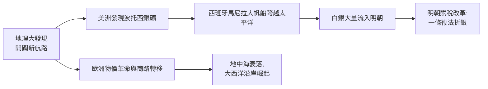

#### 【表格 8-1】時空雙軸筆記法版面結構規劃與繪製規範表
| 軸線/圖層 | 空間分配 | 填寫內容與視覺符號 | 考場提分關鍵思維 |
| :--- | :--- | :--- | :--- |
| **橫向經線 (時間)** | 筆記上方 5 公分橫欄 | 世紀年代刻度、重大分期點（如 1453 君士坦丁堡陷落）。 | 消除「同期歷史不同地區無法串聯」的盲點。 |
| **縱向緯線 (區域)** | 筆記主體分成 3~4 橫帶 | 東亞 / 歐洲 / 美洲及非洲，由上而下排列。 | 橫看成嶺側成峰：橫向讀看互動，縱向讀看本土演進。 |
| **圖層一：貿易物質流** | 綠色雙向箭頭 + 實線 | 白銀、香料、黑奴、茶葉、煙草的流向路線與港口。 | 掌控近代世界經濟史與地理全球化核心考題。 |
| **圖層二：思想制度流** | 紫色虛線 + 氣泡框 | 宗教信仰傳播（天主教傳教士東來）、啟蒙思潮流動。 | 掌握文化交融與跨國制度比較。 |
| **地理側欄縮圖** | 頁面右側 20% 區域 | 季風洋流分佈圖、地形戰略隘口示意簡圖。 | 解釋歷史事件發生的地理必然性（如鄭和下西洋順風）。 |

#### 【表格 8-2】16 世紀跨國跨區域同期歷史對照與地理套疊分析範本表
| 地理板塊 | 16 世紀政治演替 (橙) | 16 世紀經濟物產流動 (綠) | 16 世紀思想科技文化 (紫) |
| :--- | :--- | :--- | :--- |
| **歐洲 (西歐/中歐)** | 查理五世哈布斯堡帝國；宗教戰爭爆發；西班牙稱霸。 | 物價革命；大西洋三角貿易發軔；威尼斯商路衰退。 | 馬丁·路德宗教改革；文藝復興高潮；哥白尼日心說。 |
| **東亞 (明朝/日本)** | 明世宗/神宗朝；倭寇與北虜之患；日本戰國時代 $\to$ 織豐體系。 | 美洲/日本白銀大量流入；一條鞭法實施；市鎮繁榮。 | 陽明心學流行；利瑪竇來華傳播西方曆法；南蠻文化入日。 |
| **美洲新大陸** | 西班牙征服阿茲特克、印加帝國；設立西印度總督區。 | 波托西銀礦爆發式開採；種植園引進甘蔗與黑奴勞動。 | 天主教方濟各會傳播；本土印第安古文明遭毀滅。 |

---

<a id="方法九"></a>
## 方法九：建中「原型母題拆解與一題多解收斂法」 (Paradigm Mother Problem & Multi-Angle Convergence)

### 1. 理論溯源與名校實踐背景
建國中學數理資優班、國際數學/物理奧林匹亞競賽選手的頂尖武器。平庸的刷題者追求「刷題數量（盲目刷 5000 題）」，結果一遇到新題型就陣亡；建中學霸追求**「題眼提煉（精研 50 道原型母題）」**。針對一道極具代表性的幾何或代數母題，動用 3~5 種截然不同的數學工具破解，建立強大的解法收斂庫。

### 2. 腦神經科學與認知心理學深層機轉
* **基模遷移理論 (Schema Transfer Theory)**：心理學研究顯示，單一解法只能建立僵化的局部突觸連結；當對同一核心問題調用不同腦區（如：純幾何直覺調用枕葉，坐標解析調用頂葉代數區）進行多次求解時，大腦能抽取出抽象的**「深層結構基模 (Deep Schema)」**。
* **思維靈活性與認知發散 (Cognitive Flexibility)**：高難度聯考或競賽題表面上包裝華麗，本質上都是經典母題的變形。一題多解訓練能讓前額葉神經網絡隨時自由切換解題視角。

### 3. 操作三原則：抓母題 ➔ 演多解 ➔ 繪族譜
1. **精準篩選原型母題 (Paradigm Problem)**：挑選蘊含經典核心定理、且能引申多種解法的代表題（如：柯西不等式極值題、圓錐曲線弦長中點題）。
2. **強迫一題多解 (Multi-Angle Solving)**：
   - 解法一：**純幾何/物理直覺法**（利用對稱性、輔助線或虛功原理，最優雅迅速）。
   - 解法二：**向量/坐標解析幾何法**（暴力建系，演算法最通用穩妥）。
   - 解法三：**代數不等式/微積分極值法**（求導、拉格朗日乘子，最適合極限邊界）。
3. **繪製變形題族譜 (Problem Lineage Tree)**：在母題下方整理出 3~4 個近年大考的變形題，標明「增加了什麼干擾條件」、「改變了什麼幾何背景」。

### 4. 搭配圖示與表格

#### 【圖示 9-1】原型母題衍生變形題族譜與思維收斂圖
```mermaid
graph TD
    Mother[【原型母題: 橢圓焦點三角形面積最大值】<br>核心條件: a, b, c 與離心率 e]
    
    Mother --> S1[解法 1: 幾何正切半角公式 S = b^2 tan(θ/2)]
    Mother --> S2[解法 2: 向量外積與坐標代數法 S = 1/2 |y_P * 2c|]
    Mother --> S3[解法 3: 三角函數參數式求導極值法]

    Mother --> V1[變形題 1: 雙曲線焦點三角形 (符號反轉)]
    Mother --> V2[變形題 2: 拋物線焦點弦長極值 (離心率 e=1)]
    Mother --> V3[變形題 3: 空間立體坐標系中單葉雙曲面截面]

    S1 -. 提煉共性基模 .-> Core[深層幾何本質: 圓錐曲線幾何定義與焦半徑特性]
    S2 -. 提煉共性基模 .-> Core
    S3 -. 提煉共性基模 .-> Core
```

#### 【圖示 9-2】一題多解思維切換與解法效率評估決策流
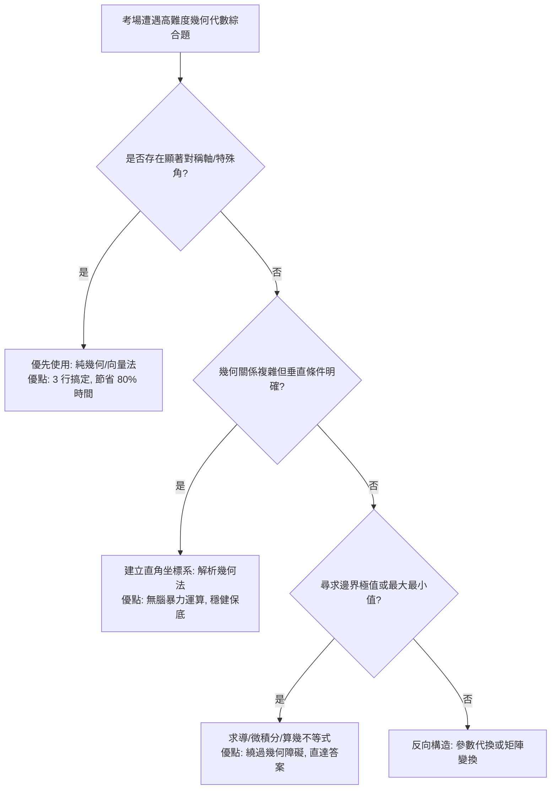

#### 【表格 9-1】經典母題之四重解法維度與思維路徑對比表
| 解法維度 | 核心運算工具 | 思維優勢與痛點 | 考場適用情境 |
| :--- | :--- | :--- | :--- |
| **維度 1：綜合幾何法** | 輔助圓、角平分線定理、相似形 | **極快極優雅**；但極度依賴瞬間靈感，若找不到輔助線容易卡死。 | 選擇題、填空題，需在 1 分鐘內秒殺搶分。 |
| **維度 2：向量分析法** | 向量內積、外積、柯西不等式 | **避開繁瑣坐標**；公式簡潔，運算量適中。 | 出現夾角、模長、投影或垂直條件之題目。 |
| **維度 3：坐標解析法** | 平面直角坐標系、直線與二次曲線聯立 | **絕對保底通用**；毫無靈感也能做，但運算量巨大容易算錯。 | 大考非選計算題，需要穩拿步驟分數。 |
| **維度 4：參數與微積分法** | 三角代換 ($x = a\cos\theta$)、一階導數極值 | **化二元為一元**；直接將幾何問題降維為單變數函數。 | 專門破解尋求「最大值、最小值、範圍區間」之極值題。 |

#### 【表格 9-2】學霸「母題庫」建檔規範與題目篩選指標表
| 審查維度 | 合格母題標準 (Pass) | 淘汰劣質題目 (Drop) | 學霸挑題心法 |
| :--- | :--- | :--- | :--- |
| **代表性 (Archetype)** | 題目涵蓋 2 個以上核心定理，為歷年模考或大考的原型。 | 單純考死記硬背或偏門冷僻的技巧題。 | 「做一題通十題，而不是做十題懂一題。」 |
| **延伸性 (Extensibility)**| 題目可以輕鬆改換數字、維度或增添限制條件變成 3 道新題。 | 條件極度特化，稍微改動一點條件便無法求解。 | 觀察該題能否演化出母子題譜系。 |
| **解法多樣性 (Diversity)** | 至少具備 2 種不同思考切角（如：代數與幾何雙解）。 | 只有唯一一種死板運算法。 | 訓練思維視角的自由切換與驗算交叉檢查。 |

---

<a id="跨方法整合"></a>
## 跨方法整合：學霸九大心法如何賦能 NChain 記憶體系

在本專案 `NChain` 數字鎖鏈記憶訓練系統中，這 9 種學霸心法能與我們的「00-99 記憶編碼」、「記憶宮殿空間樁」及「間隔閃卡測驗」產生強大的綜效鏈結：

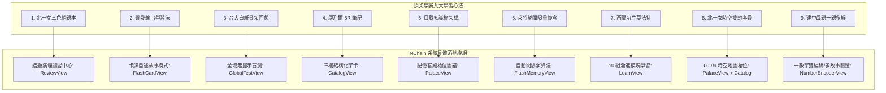

### 總結給學習者的終極心智模型：
$$\text{學霸總戰力} = \underbrace{\text{知識樹 + 時空雙軸}}_{\text{全域宏觀地圖}} \times \underbrace{\text{費曼輸出 + 白紙回想 + 一題多解}}_{\text{多維深層神經加工}} \times \underbrace{\text{三色錯題 + 萊特納盒}}_{\text{動態消滅弱點}} \times \underbrace{\text{西蒙切片}}_{\text{極致單點擊穿}}$$

透過以上 9 大方法與 NChain 科學記憶工具的深度結合，學習者能徹底告別低效率的疲憊苦讀，轉化為具備「精確架構、深度提取、動態消滅、立體關聯」的頂尖超級大腦！
